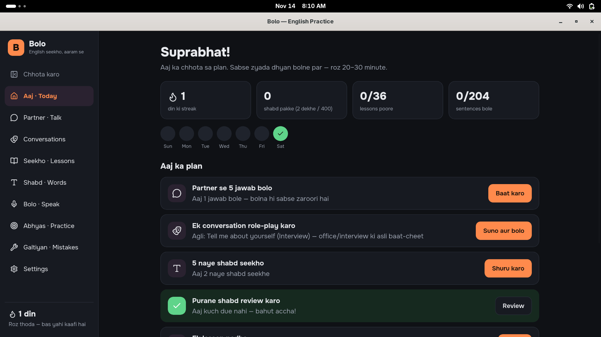

# Bolo

**Offline English speaking practice for Indian software developers.**

Bolo is for people who can *understand* English but freeze when they have to *speak* it, and have nobody to practise with. It is a Linux desktop app that runs fully on your own machine: no account, no cloud, no API key. Your voice never leaves the laptop.

The interface works in **Hinglish** (Hindi written in English letters) or plain **English**. Switch any time in Settings → Language.



## Features

| Section | What it does |
|---|---|
| **Today** | A short daily plan: talk, role-play, new words, review, a lesson, speaking, a test. Streak and weekly view. |
| **Partner · Talk** | Voice conversation with a local AI in 16 scenarios (HR round, technical interview, STAR questions, salary talk, stand-up, client call, apology, resignation, small talk...). Your speech is transcribed, the partner replies out loud, and your sentence is corrected with the changed words highlighted. Corrections become your own drill. |
| **Mock interview** | Part of Talk. A formal practice round of 8 questions (HR, technical or behavioural): no hints, corrections held back until the end, then a summary with average answer length, filler phrases, answers needing correction, and advice. |
| **Call interviews** | A dedicated track for phone and video interviews: 5 lessons (setup and opening, how to talk on a call, how to respond to common questions, handling audio problems and nerves, closing and follow-up), 5 call dialogues, phone-screening and video-interview partners in Talk, and a mock call round. |
| **Conversations** | 32 scripted dialogues (interview, office, HR and career, client calls, social) with key phrases. Listen to both sides, then role-play your part; the app scores what it heard. |
| **Lessons** | 6 professional-speaking lessons plus 30 basics lessons, each with a mini test. |
| **Words** | 400 words in 20 topics with Hindi meaning, pronunciation, example sentence and spaced-repetition review. |
| **Speak** | 204 sentences in 17 packs: listen, speak along, record yourself, play back, and check. |
| **Practice** | 9 drill types: meaning, reverse, listen, spell, fill the blank, build the sentence, fix the mistake, **call replies** (pick the best answer to an interviewer on a call), my mistakes. |
| **Mistakes** | 66 common English mistakes made by Hindi speakers, with the reason. |

Also: a choice of Ollama model for Talk (Settings), daily speaking stats (words spoken, average per answer), light, dark and auto themes, a collapsible sidebar, adjustable voice speed, and a one-click progress backup.

## How the AI parts work (all local)

- **Speech to text:** [faster-whisper](https://github.com/SYSTRAN/faster-whisper) `base.en`, int8 on CPU.
- **Conversation and correction:** [Ollama](https://ollama.com) running `qwen2.5:3b-instruct`. The reply and the correction are two separate calls, so the conversation is never blocked.
- **Voice:** [Piper](https://github.com/rhasspy/piper) (`lessac` and `ryan`), falling back to `espeak-ng`.

The small model is the main limitation: replies can be generic and some mistakes are missed. Corrections show the better sentence with a diff and never an AI-written explanation, because those were wrong too often. See [DECISIONS.md](DECISIONS.md) for the reasoning and for what has not been verified.

## Requirements

- Linux with PipeWire (`pw-record`, `pw-play`)
- Rust toolchain (stable)
- Python 3 with the `venv` module (`python3-venv` on Debian/Ubuntu) for the content build and the speech tools
- For **Talk**: [Ollama](https://ollama.com/download), about 2.5 GB of disk for the models
- Optional: `espeak-ng` as a fallback voice

`install.sh` checks for these and tells you what to install.

Lessons, words, drills and Conversations work without any of the AI tools. Only Talk and the speech scoring need them.

## Install

One step. This builds the app, installs it to `~/.local/bin` with a menu entry, and installs the AI parts (about 2 GB, once): the voice, speech recognition and the chat model.

```bash
git clone https://github.com/rave10x/bolo.git
cd bolo
./install.sh            # add --no-ai to skip the AI download
```

It asks for your password only if Ollama has to be installed. If you skip the AI step, or something fails, open **Talk** or **Settings** in the app and press **Install AI**; it runs the same installer in the background and shows its progress. You can also run `bash scripts/install-ai.sh [all|voice|talk]` yourself.

Prebuilt Linux binaries are attached to each [release](https://github.com/rave10x/bolo/releases) (you still need the AI step above for Talk).

Just building without installing:

```bash
cargo build --release && ./target/release/bolo
```

## Content

All content is plain text, built into JSON that is embedded in the binary.

```
tools/words.txt  phrases.txt  dialogues.txt  mistakes.txt   source lists
tools/lessons_*.py                                         lesson text
tools/build.py                                             validate + build content/*.json
tools/en_ui.py  en_content.json  en_build.py               English translations -> content/en.tsv
```

```bash
python3 -I tools/build.py      # rebuild and validate content
python3 -I tools/en_build.py   # rebuild the Hinglish -> English table
cargo test                     # includes a check that every lesson, dialogue and mistake note has an English entry
```

The validator rejects example sentences that do not contain their word, duplicate ids, bad quiz answers, and dialogues missing a speaker.

### Adding a translation

The interface text is written in Hinglish in the source. `content/en.tsv` maps each Hinglish string to its English version. Add a line to `tools/en_ui.py` (interface) or `tools/en_content.json` (lessons and notes), then run `tools/en_build.py`. Text with no entry is shown as written.

## Progress and data

Progress is a single JSON file at `~/.local/share/bolo/state.json`. Settings → Backup copies it to `~/Documents`. Everything stays on your machine.

## Credits

- Interface font: Onest (SIL Open Font License)
- Icons: [Lucide](https://lucide.dev) (ISC license)
- Built with [Dioxus](https://dioxuslabs.com)

## License

[MIT](LICENSE)
